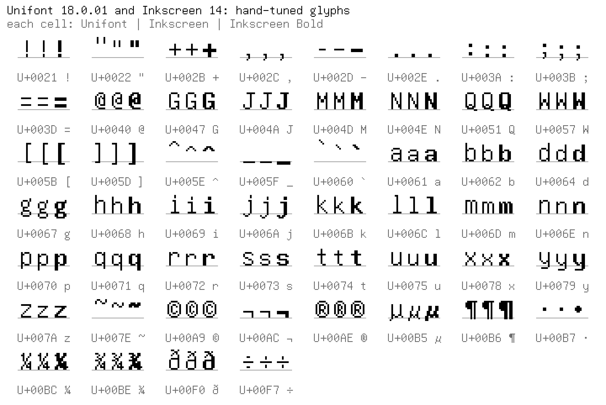
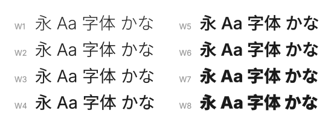

# Caffeine Type

Fonts from Caffeine Type Foundry, and the tools that build them.

## Inkscreen 14

A screen font in Regular and Bold, based on GNU Unifont. Unifont's
Latin glyphs use 16 rows. Inkscreen fits them into 14 (x-height 8 -> 7
rows, descenders 2 -> 3, accents moved to suit) in the same 8x16
cell, and changes some details by hand. Bold is 9 px wide, so the
extra stroke pixel never closes the empty column between letters.
Covers ASCII and Latin-1.

The glyphs changed by hand, next to Unifont:

- `fonts/inkscreen14.bdf`, `fonts/inkscreen14b.bdf`: the fonts
- `tools/mkinkscreen.py`: builds them from Unifont and the hand edits
  in `tools/inkscreen-overrides.txt`
- `tools/inkscreenedit.py`: pixel editor in the browser
- `tools/bdf2ttf.py`: BDF to pixel-outline TrueType
- `tools/mkcompare.py`: the overview image above

## Inksans CJK

A sans-serif font for Chinese, Japanese and Korean, based on Noto Sans
CJK at fixed weights. Inter supplies the Latin, Greek and Cyrillic.
The eight weights, W1 to W8, match the stroke weights of Hiragino Sans
W1 to W8. Each weight is one font collection with five regional faces:
JP, KR, SC, TC and HK.

Why not use Noto Sans CJK? Its weights are not on the W scale. Noto
Regular (400) is close to W4, and Noto Bold (700) is between W6 and
W7. Thus a design for Hiragino W3 and W6 gets lighter or darker text
on a system without Hiragino. Inksans keeps the Hiragino weights on
all systems. Each weight is a static font with a name like the
Hiragino Sans names (`Inksans CJK JP W3`), so apps without variable
font support can also use it.

W numbers are not a standard. Each Japanese foundry has its own scale.
Inksans uses the scale of Hiragino Sans. The measurements are in
[docs/inksans-weights.md](docs/inksans-weights.md).

- `tools/mkinksans.py`: builds `build/InksansCJK-W{1..8}.ttc` from
  the variable Noto Sans CJK and Inter. It downloads and checks the
  two fonts on the first run.
- `tools/mkpreview.py`: the preview image above
- `tools/measureweights.py`: measures Hiragino Sans against the Noto
  weight axis (macOS only)

## Releases

Downloads are on [GitHub Releases](https://github.com/salmonization/caffeine-type/releases).
Try the fonts at [type.caffeine.ink](https://type.caffeine.ink).
`tools/dist.sh inkscreen` or `tools/dist.sh inksans` writes a release
package to `build/`.

## License

The fonts are licensed under the SIL Open Font License 1.1
([fonts/OFL.txt](fonts/OFL.txt) for Inkscreen,
[fonts/OFL-inksans.txt](fonts/OFL-inksans.txt) for Inksans CJK). The tools are BSD-2-Clause
([LICENSE](LICENSE)).

Hiragino is a trademark of SCREEN Holdings Co., Ltd. Inksans CJK
contains no Hiragino outlines. We only measured the weights of
Hiragino Sans.
